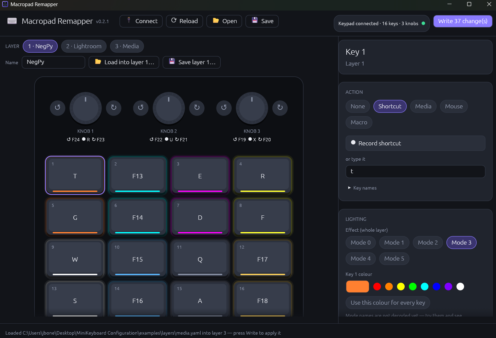

# Macropad Remapper

**Open-source configurator for the cheap "MINI_KEYBOARD" macropads** sold on AliExpress,
Amazon and elsewhere: the little 3–16 key pads, often with rotary knobs, that ship
with a closed Windows tool from a Google Drive link.



**[⬇ Download for Windows, macOS and Linux](https://github.com/jboneng/macropad-remapper/releases/latest)**

Macropad Remapper replaces that tool. It runs on Windows, Linux and macOS, and gives you:

- **A desktop app** (`macropad-remapper-gui`) that shows your keypad as it looks, with keys,
  knobs and LED colours you can click to edit. Known models are drawn with their real
  layout: 3+1, 5, 6, 6+2, 9+3, 12+2, 15+3 and 16+3 keys + knobs.
- **A command-line tool** (`macropad-remapper`) that saves and loads your setup as plain
  YAML files you can keep in git.
- **A documented protocol** ([docs/protocol.md](docs/protocol.md)), so the knowledge
  survives even if this project doesn't.

| Supported keypads | USB ID |
|---|---|
| Tested | `514C:8850` (16 keys + 3 knobs). Every kind of action below has been written to it and checked |
| Expected to work (same protocol) | `1189` or `514C` with product `8830`, `8831`, `8832`, `8833`, `8840`, `8842`, `8851` |

Some older `1189:8840/8842/8890` boards use a different protocol. If yours doesn't answer
the connect step, try [ch57x-keyboard-tool](https://github.com/kriomant/ch57x-keyboard-tool).

## What you can assign

- **Shortcuts:** any key with any modifiers, e.g. `Ctrl+Shift+Esc`, `F13`, `!`.
- **Media keys:** play/pause, next, previous, volume, mute, calculator, browser back, …
- **Mouse:** left/middle/right click, scroll up/down, optionally while holding Ctrl/Shift/Alt.
- **Timed macros:** up to 18 key taps with a delay of up to 60 s before each.
- **LEDs:** a colour per key, and an effect per layer:

  | Effect | What it does |
  |---|---|
  | Off | All LEDs off |
  | Steady | Every key glows in its own colour |
  | Light on press | A key lights up only while pressed |
  | Ripple | The light spreads from the pressed key to its neighbours |
  | Wave | Steady colours with a fading wave across the pad |
  | Gradient | Built-in green-to-amber gradient |

- **Layers and knobs:** all of the above for each of the 3 layers, and for knob
  turn-left / press / turn-right.
- **Per-app layer files:** save a layer as e.g. `lightroom.yaml` and load it into any
  layer, or combine several in one setup file. Ready-made layers for
  [NegPy](examples/layers/negpy.yaml), [Lightroom Classic](examples/layers/lightroom.yaml)
  and [media control](examples/layers/media.yaml) are in [examples/layers](examples/layers).

> **Good to know:** after you save key changes, the keypad stops updating its LEDs until
> you unplug it and plug it back in. Your settings are stored; the replug just makes them
> show. The app reminds you when it's needed.

## Quick start

**Desktop app:** start `macropad-remapper-gui`, click **Connect**, click a key, change it,
then click **Write**.

**Command line:**

```sh
macropad-remapper info                         # what keypad is connected?
macropad-remapper dump -o my-keypad.yaml       # save the current setup
# …edit my-keypad.yaml…
macropad-remapper upload my-keypad.yaml --dry-run   # preview the changes
macropad-remapper upload my-keypad.yaml             # back up, then write only what changed
```

The **[User guide](docs/user-guide.md)** walks through everything step by step, including
the profile file format and troubleshooting.

No keypad yet? Try `macropad-remapper-gui --simulate 16,3` or
`macropad-remapper --simulate 16,3 info`.

## Safety

- The current setup is **backed up to a YAML file before every write**.
- **Only changed keys are written**, and the whole change set is validated first, so a typo
  can't leave the keypad half-written.
- **Nothing is lost on a round trip.** Settings the tool doesn't understand yet are kept
  byte-for-byte: a dump uploaded back writes nothing.
- **Risky commands are gated.** Changing the keypad's layout preset needs an explicit flag.
  The vendor's "enter firmware-update mode" command is not implemented at all.
- **The app never talks to the network.**

## Building from source

Requires Rust 1.80 or newer.

```sh
git clone https://github.com/jboneng/macropad-remapper
cd macropad-remapper
cargo build --release      # binaries end up in target/release/
cargo test --workspace
```

- **Linux:** install `libudev-dev`, `libusb-1.0-0-dev` and `libgtk-3-dev` first. Then copy
  [packaging/99-macropad-remapper.rules](packaging/99-macropad-remapper.rules) to
  `/etc/udev/rules.d/` so you don't need `sudo`.
- **macOS:** the first connect may ask for *Input Monitoring* permission.

### Project layout

| Crate | What it does |
|---|---|
| `crates/proto` | Pure encoding and decoding of the HID protocol and the YAML profile format (no I/O) |
| `crates/device` | USB HID access (via `hidapi`), the safe write planner, and a simulated keypad |
| `crates/cli` | The `macropad-remapper` command-line tool |
| `crates/gui` | The `macropad-remapper-gui` desktop app (egui) |

`crates/device/examples/` contains read-only diagnostics (`probe`, `handshake`, `rawquery`)
for investigating new keypad models.

## Help wanted

The protocol is now well understood: [docs/protocol.md](docs/protocol.md) marks what was
confirmed on hardware and what is still open. Things you can help with:

- **Other keypad models.** Only the 16-key + 3-knob `514C:8850` has been tested. If you
  have another size, please open an issue with the output of `macropad-remapper info`
  and whether reading and writing work.
- **Older firmware** (protocol generation below 10) is read-only for now; a tester would
  help make it writable.
- **The vendor's phone-gesture mouse actions** (*Like* and four swipes) are kept as they
  are, but their exact codes haven't been confirmed.

See [CHANGELOG.md](CHANGELOG.md) for release history.

## License

MIT OR Apache-2.0, at your option. Not affiliated with any hardware vendor. No vendor code
is included; the protocol was documented from observation for interoperability.
