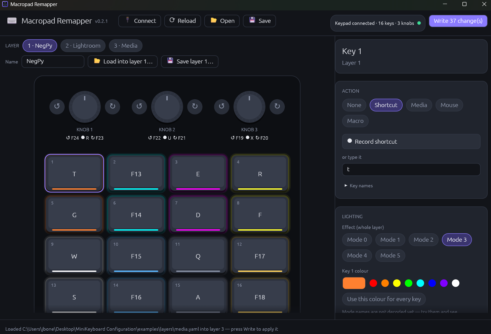

## What's new in 0.4.0

**The app can now update itself.**

- When the app starts, it checks GitHub for a newer release. If there is one, a purple **⬆ vX.Y.Z available** button appears next to the version number.
- Click it to read what's new, then press **Download & install**. The app downloads the right file for how you installed it, checks it against `SHA256SUMS.txt`, installs it and reopens:
  - **Windows installer:** the new installer runs silently. If you installed for all users, Windows asks for permission.
  - **Portable zips (Windows, Linux):** the app replaces its own files.
  - **macOS:** the app replaces its `.app` bundle.
  - **Linux `.deb` / `.rpm`:** you're asked for your password.
- **Skip this version** hides the button until the next release.
- **Don't want it?** Untick **⚙ → Check for updates on startup**. **⚙ → Check for updates now** checks on demand. The check only reads the public release list from GitHub; nothing about you or your keypad is sent.

**This is the first version with the updater, so 0.4.0 itself has to be installed by hand.** From now on, new versions arrive through the app.

---

**Macropad Remapper is an open-source replacement for the closed "MINI_KEYBOARD" configuration tool** that ships with the cheap 3–16 key macropads (often with knobs) sold on AliExpress, Amazon and elsewhere. Your keypad keeps working even if the seller and their Google Drive link disappear.

Tested on a **514C:8850** (16 keys, 3 knobs). Reading the keypad and writing keys, media keys, mouse actions, macros and LED settings are all confirmed on real hardware.

## Downloads

| System | Installer (recommended) | Portable (no install, just unzip and run) |
|---|---|---|
| **Windows** 10/11, 64-bit | `macropad-remapper-0.4.0-windows-x64-setup.exe` | `macropad-remapper-0.4.0-windows-x64-portable.zip` |
| **macOS** 11+, Intel & Apple Silicon | `macropad-remapper-0.4.0-macos-universal.dmg` | `macropad-remapper-0.4.0-macos-universal-portable.zip` |
| **Linux**: Debian, Ubuntu, Mint, Pop!_OS | `macropad-remapper-0.4.0-linux-amd64.deb` | `macropad-remapper-0.4.0-linux-x86_64-portable.zip` |
| **Linux**: Fedora, openSUSE, RHEL | `macropad-remapper-0.4.0-linux-x86_64.rpm` | *(same zip)* |

Every download contains the desktop app (**Macropad Remapper**), the command-line tool (`macropad-remapper`) and the `examples/` folder with ready-made layers. `SHA256SUMS.txt` lists checksums for all files.

### First launch

The builds are not code-signed, so your system will warn you the first time:

- **Windows:** if SmartScreen says *"Windows protected your PC"*, click **More info → Run anyway**. The installer works without admin rights.
- **macOS:**
  1. Open the `.dmg` and drag **Macropad Remapper** to *Applications*.
  2. The first time, **right-click the app → Open → Open**. On macOS 15+, use *System Settings → Privacy & Security → Open Anyway*.
  3. If macOS asks for *Input Monitoring* access, allow it.
- **Linux:** the `.deb` and `.rpm` install a udev rule, so you don't need `sudo` to use the keypad (unplug and replug it once after installing). With the portable zip, install the rule yourself:
  `sudo cp 99-macropad-remapper.rules /etc/udev/rules.d/ && sudo udevadm control --reload && sudo udevadm trigger`

## What you can do

- **See your keypad as it looks:** each known model is drawn with its real layout, and each key shows its action and glows in its LED colour.
- **Assign shortcuts.** Press **Record shortcut** and hit the combination (e.g. `Ctrl+Shift+Esc`), or type it.
- **Media keys:** play/pause, next/previous, volume, mute, calculator, browser back/forward…
- **Mouse actions:** clicks and scroll, optionally with Ctrl/Shift/Alt held (Ctrl+scroll = zoom).
- **Timed macros** of up to 18 keys with delays.
- **All 3 layers,** plus each knob's turn-left / press / turn-right.
- **LED colours** per key and the effect per layer (Off, Steady, Light on press, Ripple, Wave, Gradient).
- **Per-app layer files** (NegPy, Lightroom and media examples included), loadable into any layer.
- **Save and load profiles** as readable YAML files. The command-line tool can dump, edit and upload them.

## Safety first

- **Automatic backup** of the keypad's current setup before every write.
- **Only changed keys are written,** and everything is validated before anything is sent.
- **Lossless.** Settings the app doesn't understand yet are preserved byte-for-byte.
- **No network access except the update check**, which you can turn off.

## Supported keypads

- **Tested:** `514C:8850`.
- **Expected to work (same protocol):** USB vendor `1189` or `514C` with product `8830`–`8833`, `8840`, `8842` or `8851`.
- Some older `1189:8840/8842/8890` boards use a different protocol. If yours won't connect, try [ch57x-keyboard-tool](https://github.com/kriomant/ch57x-keyboard-tool).

## Known limitations

- **LEDs after saving keys:** the keypad stops updating its LEDs until you unplug it and plug it back in. Your settings are stored.
- **Mouse "Like" and swipe gestures** (phone-style actions in the vendor tool) are kept as they are but can't be edited yet.
- **Older firmware:** keypads reporting protocol generation < 10 are read-only.

## Documentation

- [User guide](https://github.com/jboneng/macropad-remapper/blob/main/docs/user-guide.md): step-by-step for the app and the command line.
- [Protocol notes](https://github.com/jboneng/macropad-remapper/blob/main/docs/protocol.md): how the keypad talks over USB.
- [Changelog](https://github.com/jboneng/macropad-remapper/blob/main/CHANGELOG.md).

Found a bug, or tried it on another model? Please [open an issue](https://github.com/jboneng/macropad-remapper/issues) and include the output of `macropad-remapper info`.
